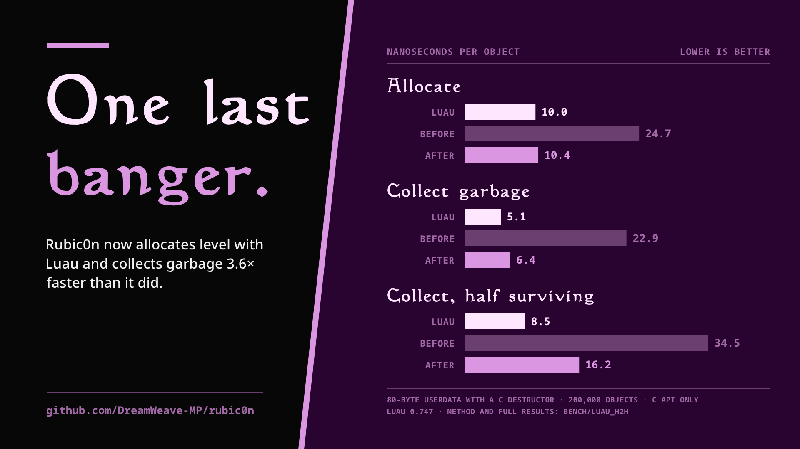

# Allocation and collection against Luau

A small C driver that measures how much it costs each runtime to allocate a
small userdata with a native destructor and to collect it again. It answers
one question: how far is this fork's paged allocator and collector from
Luau's on the object shape OpenMW produces most.

Both runtimes are driven through their C API only. There is no compiler,
interpreter or binding layer in the loop, so the numbers are the allocator
and the collector and nothing else.

## Build and run

Build LuaJIT first. Luau is built from a source checkout, VM only:

```bash
make
make -C bench/luau_h2h LUAU_ROOT=/path/to/luau run
```

`make -C bench/luau_h2h luajit` builds the LuaJIT driver alone. Each driver
takes the object count, the number of measured rounds and a label:

```bash
bench/luau_h2h/build/h2h_luajit 200000 61 after
```

## What is measured

Each round runs three shapes. Each is timed as allocation with the collector
stopped, then as two full collections, in nanoseconds per object.

- **churn**: N userdata with a 28 byte payload, all garbage.
- **half-retained**: the same, with every other one kept alive by a table.
- **table**: N empty tables, all garbage.

The LuaJIT userdata has a zero-upvalue C `__gc`, as Sol installs. The Luau
userdata is tagged, with a destructor registered for its tag. Both set the
metatable with the same three API calls. `h2h_luau_onecall` uses Luau's
single call instead.

A 28 byte payload makes an 80 byte block in LuaJIT (48 byte header) and a
48 byte block in Luau (16 byte header). That difference is part of what is
being compared.

## Results

Linux x86-64, GCC 13.3 at `-O2`, Luau 0.747, Xeon at 2.3 GHz, 2 cores. Each
figure is the lowest of 7 runs of the median over 61 rounds. "before" is
71f6728e, "after" is the tip of this series.

20,000 objects:

|                | churn alloc | churn collect | half alloc | half collect | table alloc | table collect |
|----------------|------------:|--------------:|-----------:|-------------:|------------:|--------------:|
| Luau           |         9.5 |           4.9 |       10.8 |          5.8 |         6.9 |           3.9 |
| Rubic0n before |        11.8 |          21.1 |       12.8 |         24.2 |        10.4 |           7.3 |
| Rubic0n after  |         9.3 |           5.2 |        9.6 |          7.7 |         7.1 |           4.2 |

200,000 objects:

|                | churn alloc | churn collect | half alloc | half collect | table alloc | table collect |
|----------------|------------:|--------------:|-----------:|-------------:|------------:|--------------:|
| Luau           |        10.0 |           5.1 |       11.5 |          8.5 |         7.5 |           4.2 |
| Rubic0n before |        24.7 |          22.9 |       26.0 |         34.5 |        17.5 |           8.5 |
| Rubic0n after  |        10.4 |           6.4 |       10.9 |         16.2 |         8.1 |           5.2 |

Allocation is level with Luau. Collecting pure garbage is within a quarter
of it. Collecting a heap with survivors is still up to twice as slow at
200,000 objects.

That last gap is structural. Luau sweeps its heap page by page and frees
objects in place. LuaJIT walks a linked list through every object header,
and each of its userdata is 80 bytes where Luau's is 48, so the same walk
touches more memory. Closing it would mean sweeping by page, which changes
how every GC object is linked.

The "before" figures at 200,000 objects include page faults. That build
returned every empty page to the bundled allocator, which unmaps free
memory above 2 MiB, so each round mapped its heap again.

## The comparison image



`comparison.png` is the 200,000 object table as bars, for release notes. Its
alt text is `comparison.txt`. `comparison.jsl` draws it with
[Jess](https://github.com/DreamWeave-MP/jess) and its `magick` and `truetype`
packages, in the style of DreamWeave's `dream_propaganda` campaign:

```bash
jess run --trusted --package truetype.jpk --package magick.jpk \
  bench/luau_h2h/comparison.jsl \
  --font-dir ~/.local/share/fonts --font-dir /usr/share/fonts/google-noto
```

It needs `MysticCards.ttf`, `NotoSans-Medium.ttf` and `NotoSansMono-Bold.ttf`
in the folders named. The figures are copied into the script by hand: change
the table above first, then the script.

The collection figures are for explicit full collections. See
`bench/openmw_userdata` with `--gc incremental` for the collector running
in steps behind a Sol binding.
